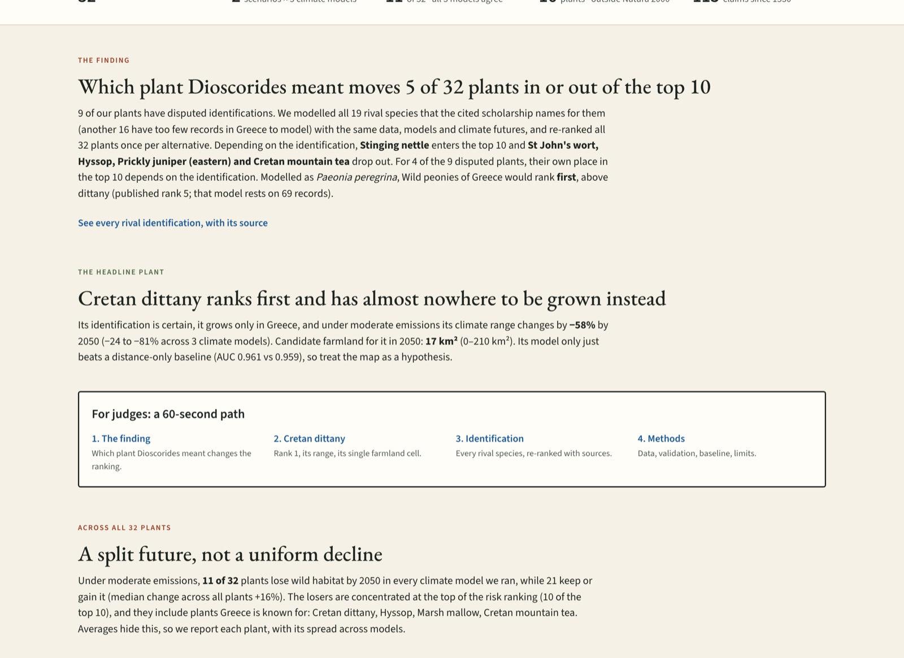
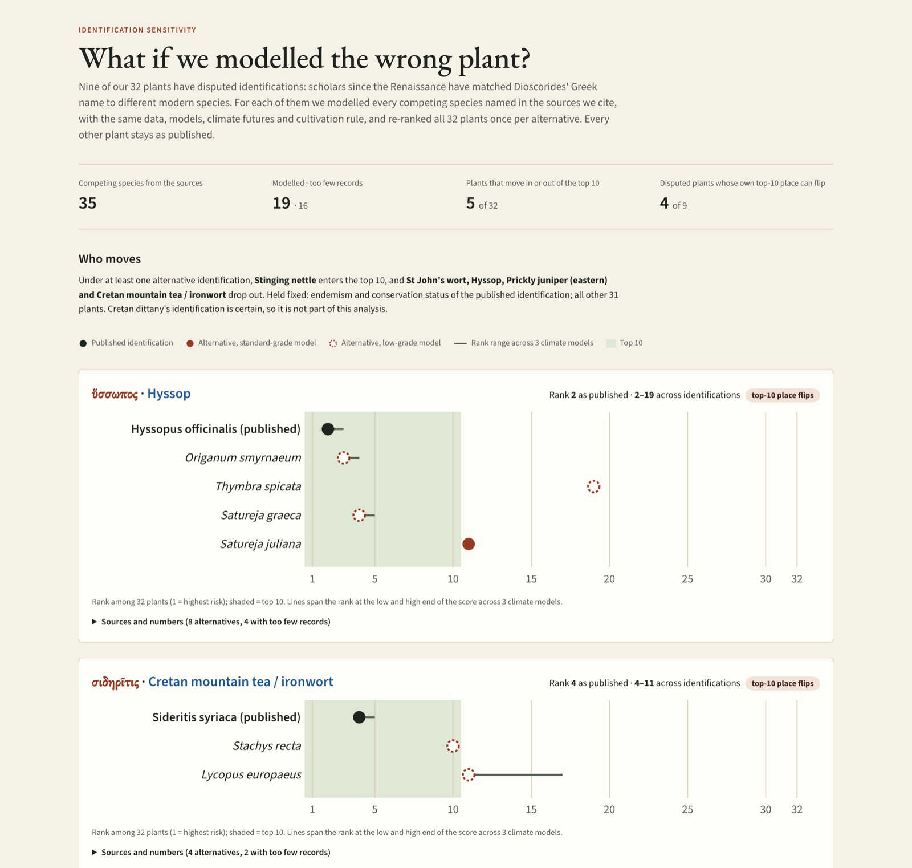
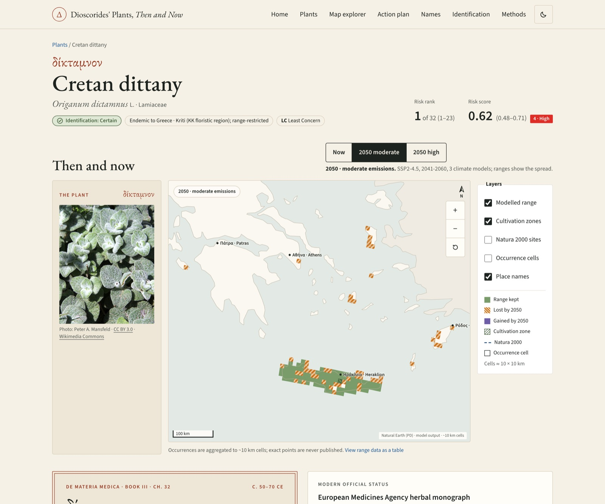
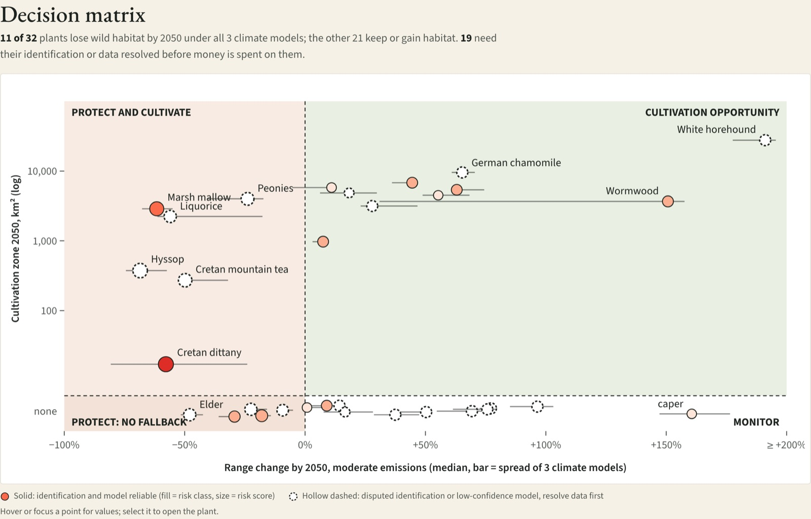
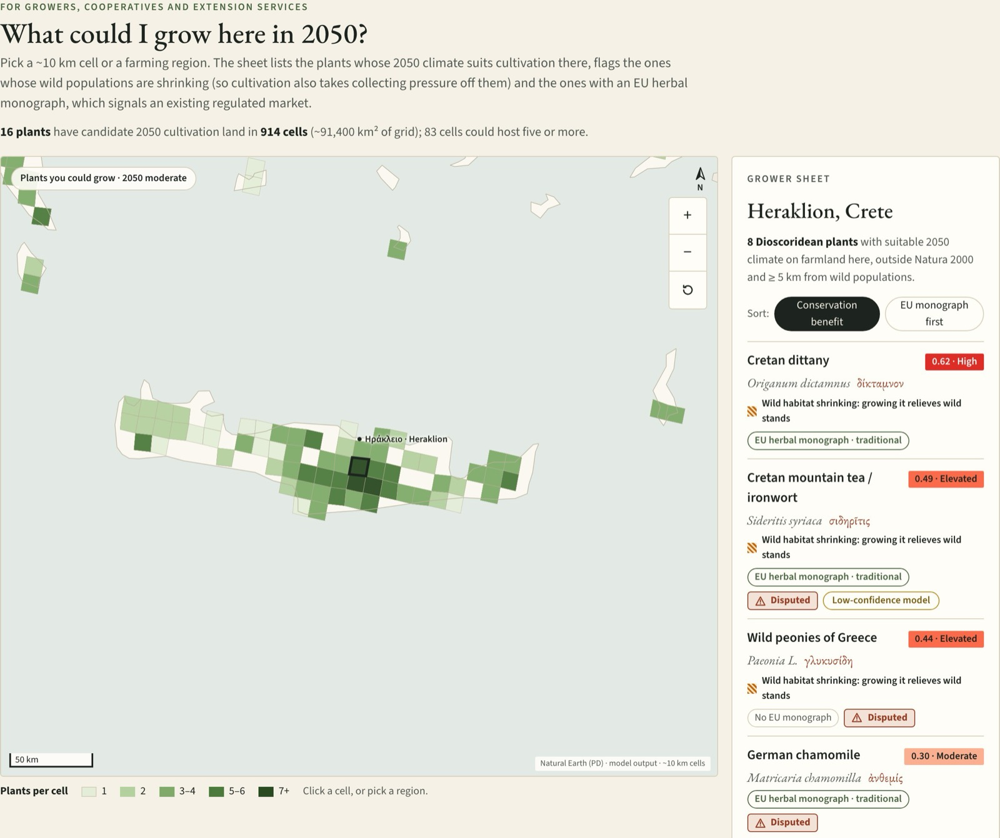
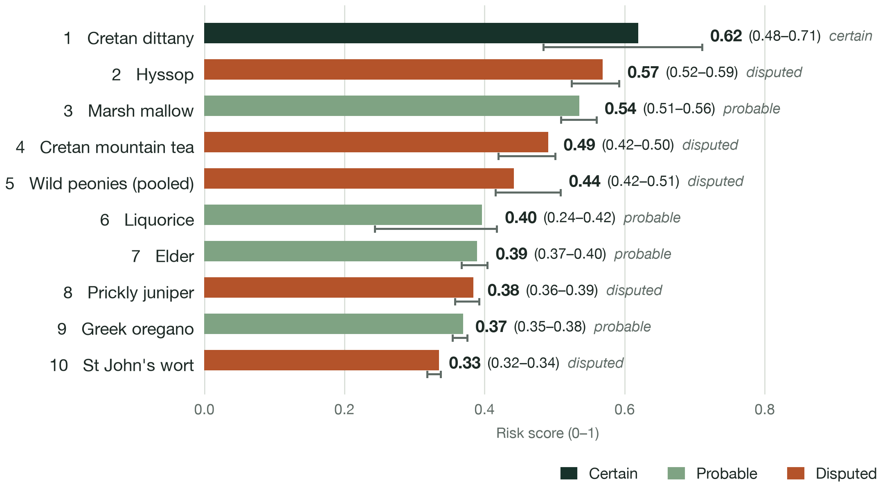
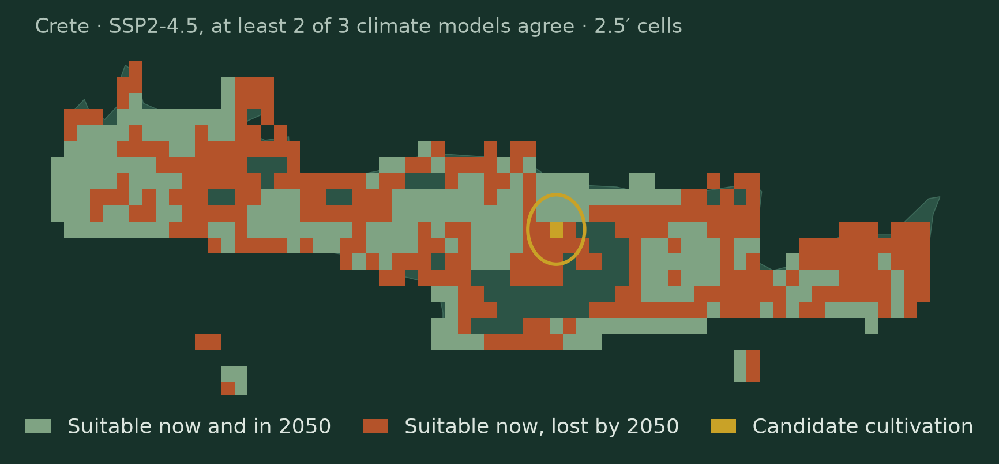
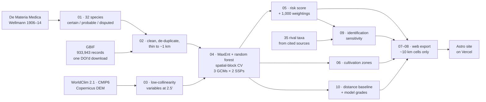

<div align="center">

# Materia Medica 2050

### How the plants that founded pharmacy fare by 2050, and how uncertain their ancient identities are

**[Live site](https://materia-medica-2050.vercel.app)** · **[Pitch video](https://www.youtube.com/watch?v=ZBNGBJ5rhTk)** · **[Deck (.pptx)](docs/materia-medica-2050.pptx)** · **[Methods](https://materia-medica-2050.vercel.app/methods/)** · **[Limitations](LIMITATIONS.md)**

EthnoHack 2026 · Track 3 · Ethnopharmacology research prototype

<a href="https://materia-medica-2050.vercel.app"></a>

</div>

> **Research prototype. Not medical advice.** Every result is a model-based hypothesis shown with its uncertainty.

We model where 32 medicinal plants from Dioscorides' *De Materia Medica* (1st century CE) that grow wild in Greece could survive by 2050, how much risk each one faces, and where each could be cultivated instead. **Our headline finding is that the history of a plant's name moves the ranking more than the climate weighting does.** Nine of the 32 plants have disputed identifications. We modelled all 19 rival species named for them in the scholarship we cite (16 more are too rare in Greece to model) and re-ranked all 32 plants once per alternative. **5 of 32 plants move in or out of the top 10 depending on which plant Dioscorides meant.** Hyssop can fall from rank 2 to 19, and modelled as *Paeonia peregrina* the peony would rank first, above Cretan dittany. Dittany itself has a certain identification and ranks first as published: under moderate emissions its climate range changes by a median of −58% by 2050 (−81% to −24% across three climate models), and only one ~17 km² cell of farmland (0–210 km²) could grow it instead.

## For judges

| | |
|---|---|
| **Live site** | https://materia-medica-2050.vercel.app |
| **Pitch video** | https://www.youtube.com/watch?v=ZBNGBJ5rhTk |
| **Deck** | [`docs/materia-medica-2050.pptx`](docs/materia-medica-2050.pptx) (10 slides) |
| **60-second path** | 1. [The finding](https://materia-medica-2050.vercel.app/#finding) → 2. [Cretan dittany](https://materia-medica-2050.vercel.app/plants/origanum-dictamnus/) → 3. [Identification](https://materia-medica-2050.vercel.app/identification/) → 4. [Methods](https://materia-medica-2050.vercel.app/methods/) |

<table>
<tr>
<td width="50%"><a href="https://materia-medica-2050.vercel.app/identification/"></a><br><b>Identification.</b> For each disputed plant, its rank under every rival species named in the sources, with the rank range across climate models and the citation.</td>
<td width="50%"><a href="https://materia-medica-2050.vercel.app/plants/origanum-dictamnus/"></a><br><b>A page per plant.</b> Dioscorides' Greek text and page scan, Then/Now map, risk breakdown, model grade against the baseline, and a suggested action.</td>
</tr>
<tr>
<td><a href="https://materia-medica-2050.vercel.app/act/"></a><br><b>Action plan.</b> Habitat change × 2050 farmland sorts plants into protect and cultivate, protect only, cultivation opportunity and monitor.</td>
<td><a href="https://materia-medica-2050.vercel.app/act/#grow"></a><br><b>Grower finder.</b> What a ~10 km cell or farming region could grow in 2050, which of those plants are shrinking in the wild, and which have an EU herbal monograph.</td>
</tr>
</table>

## Results

Top 10 of 32 by risk score (SSP2-4.5). Every interval is the spread across the three climate models; the last column is the plant's rank under each rival identification (only disputed plants have one).

| # | Plant | Identification | Risk score (range) | Range change 2050, SSP2-4.5 (min to max) | Cultivation 2050, km² (range) | Model grade (AUC vs baseline) | Rank across rival identifications |
|---|---|---|---|---|---|---|---|
| 1 | Cretan dittany, *Origanum dictamnus* | certain | **0.62** (0.48–0.71) | −58% (−81 to −24) | 17 (0–210) | standard (0.961 vs 0.959) | — |
| 2 | Hyssop, *Hyssopus officinalis* | disputed | **0.57** (0.52–0.59) | −69% (−74 to −57) | 374 (211–650) | low (0.631 vs 0.639) | 2–19 |
| 3 | Marsh mallow, *Althaea officinalis* | probable | **0.54** (0.51–0.56) | −62% (−68 to −55) | 2,874 (2,420–3,562) | standard (0.869 vs 0.773) | — |
| 4 | Cretan mountain tea, *Sideritis syriaca* | disputed | **0.49** (0.42–0.50) | −50% (−52 to −32) | 272 (118–784) | low (0.876 vs 0.792) | 4–11 |
| 5 | Wild peonies of Greece, *Paeonia, pooled* | disputed | **0.44** (0.42–0.51) | −24% (−41 to −17) | 3,994 (2,686–6,121) | standard (0.822 vs 0.662) | 1–5 |
| 6 | Liquorice, *Glycyrrhiza glabra* | probable | **0.40** (0.24–0.42) | −56% (−61 to −18) | 2,231 (1,748–3,956) | low (0.939 vs 0.863) | — |
| 7 | Elder, *Sambucus nigra* | probable | **0.39** (0.37–0.40) | −48% (−52 to −42) | 0 | low (0.734 vs 0.674) | — |
| 8 | Prickly juniper (eastern), *Juniperus deltoides* | disputed | **0.38** (0.36–0.39) | −22% (−24 to −16) | 0 | standard (0.769 vs 0.662) | 8–17 |
| 9 | Greek oregano, *Origanum vulgare* | probable | **0.37** (0.35–0.38) | −18% (−19 to −14) | 0 | standard (0.761 vs 0.759) | — |
| 10 | St John's wort, *Hypericum perforatum* | disputed | **0.33** (0.32–0.34) | −9% (−10 to −5) | 0 | standard (0.772 vs 0.714) | 10–22 |

<table>
<tr>
<td width="52%"></td>
<td width="48%"></td>
</tr>
<tr>
<td><sub>Top-10 risk score; whiskers and brackets give the range across 3 climate models.</sub></td>
<td><sub>Dittany on Crete, SSP2-4.5: kept (sage), lost (rust), the one candidate cultivation cell (gold).</sub></td>
</tr>
</table>

- **Identification moves the ranking.** Under at least one rival identification, stinging nettle enters the top 10 and St John's wort, hyssop, prickly juniper and Cretan mountain tea drop out ([`outputs/identification_sensitivity.json`](outputs/identification_sensitivity.json)). Four of the five disputed top-10 plants can leave it.
- **Weights move it much less.** Under 1,000 random weightings the top 10 holds 84% of the time on average ([`outputs/risk.csv`](outputs/risk.csv), `top10_stability`).
- **A split future.** 11 of 32 plants lose habitat under all three climate models; the other 21 keep or gain climate space, gains that assume unlimited dispersal.
- All 32 plants: [`outputs/risk.csv`](outputs/risk.csv), [`outputs/cultivation.csv`](outputs/cultivation.csv), [`outputs/model_grades.csv`](outputs/model_grades.csv).

## Methods



1. **Species and identifications.** 32 plants from Wellmann's Greek edition, matched to modern species from published identifications (Sprengel 1830, Fraas 1845, Osbaldeston 2000 and others) and rated certain, probable or disputed. Every rival identification and its source is in [`data/curated/identifications.csv`](data/curated/identifications.csv); the 35 we model are in [`identification_candidates.csv`](data/curated/identification_candidates.csv).
2. **Occurrences.** One GBIF download of all vascular plants in the study box: 933,943 records, [doi:10.15468/dl.4u6k8n](https://doi.org/10.15468/dl.4u6k8n). Records without coordinates, at country centroids or institutions, duplicated, before 1970 or with uncertainty over 5 km are dropped, then thinned to one per ~1 km cell. The same download is the **target-group background**, so the models learn climate rather than survey effort.
3. **Environment.** WorldClim 2.1 bioclim at 2.5′ (~4.6 km) for 1970–2000 and 2041–2060 under MPI-ESM1-2-HR, MRI-ESM2-0 and IPSL-CM6A-LR × SSP2-4.5 / SSP5-8.5, with Copernicus DEM elevation and slope; variables kept at |r| < 0.7.
4. **Models.** MaxEnt (elapid) and random forest, averaged; thresholded by maximum TSS; range change counted within Greece.
5. **Risk.** 0.4 range loss + 0.2 endemism + 0.2 conservation status (IUCN global, else national checklist) + 0.2 harvest access (share of range within 2 km of an OSM road or settlement).
6. **Cultivation.** Suitable in 2050 under the majority of climate models, on CORINE farmland, outside Natura 2000 and ≥ 5 km from wild records.
7. **Identification sensitivity (stage 09).** Each rival species goes through steps 2–6 unchanged; the 32 plants are re-ranked once per alternative, changing only that plant's range-loss and harvest components.

## Validation

| Check | What we did | Result | File |
|---|---|---|---|
| Spatial cross-validation | 5-fold, ~25 km spatial blocks; AUC, TSS, Boyce; random null model | Dittany AUC 0.961 ± 0.019 vs null 0.494 | `outputs/metrics/<slug>.json` |
| **Distance-only baseline** | Same folds; a held-out point scores higher the closer it is to a training record | **29 of 32** models beat it, several narrowly: dittany 0.961 vs 0.959; 3 do not (mandrake, hyssop, felty germander) | [`outputs/model_grades.csv`](outputs/model_grades.csv) |
| **Model grades** | standard = ≥ 30 records, AUC ≥ 0.75 and above the baseline; data gap = < 10 records; otherwise low | **19 standard, 13 low** of 32; 16 of 35 rival taxa are data gaps | `outputs/model_grades.csv` |
| Climate uncertainty | 3 GCMs × 2 SSPs; median and min–max everywhere | e.g. dittany −58% (−81 to −24), SSP5-8.5 −65% | `outputs/metrics/`, `risk.csv` |
| Weight sensitivity | 1,000 random weightings; ±50% one-at-a-time | Top 10 holds 84% of the time on average | `outputs/sensitivity.json` |
| **Identification sensitivity** | 19 rival species modelled, all 32 plants re-ranked per alternative | **5 of 32** plants move in or out of the top 10 | [`outputs/identification_sensitivity.csv`](outputs/identification_sensitivity.csv) |

The baseline result matters: for narrow endemics such as dittany, being near known records predicts held-out records almost as well as climate does, so its maps are best read as hypotheses.

## Limitations

Full list in [`LIMITATIONS.md`](LIMITATIONS.md) and on the [Methods page](https://materia-medica-2050.vercel.app/methods/#limits).

- **Unlimited dispersal for gains.** Correlative models assume a plant can reach every newly suitable cell, so range gains are best-case.
- **2.5′ climate.** ~4.6 km cells are coarse for gorges, cliffs and north-facing slopes.
- **Pooled taxa.** Five plants are modelled as species groups (peonies, capers, mandrake, juniper, felty germander).
- **Global IUCN status only.** Categories are global, not Greek, and unassessed species fall back to the national checklist.
- **The 5 km rule.** Excluding cells within 5 km of wild records protects wild stands but leaves 16 of 32 plants with no cultivation area at all.
- **Disputed names.** 9 identifications are disputed; rival species move 5 plants in or out of the top 10. For rivals we hold the published plant's endemism and status fixed.
- **Harvest is a proxy.** Road access saturates in Greece (0.86–0.99 across plants), so it barely separates them.
- **Sampling bias.** GBIF records cluster where botanists walk; the target-group background reduces but does not remove this.

## Built vs reused

| Built in this project | Reused |
|---|---|
| Curated list of 32 plants, 115 dated identification claims and 35 rival taxa, each with its source | Wellmann's Greek text; the identifications of Sprengel, Fraas, Osbaldeston and others |
| Pipeline stages 01–11: cleaning, models, risk, cultivation, identification sensitivity, baseline and grades, web export | elapid (MaxEnt), scikit-learn, rasterio, geopandas, pygbif |
| Risk score, sensitivity analyses, decision rules and grower index | GBIF, WorldClim/CMIP6, Copernicus DEM, CORINE, Natura 2000, OpenStreetMap, IUCN, EMA |
| JSON-Schema data contract and tests | JSON Schema, pytest |
| Website: plant pages, identification page, action plan, grower finder, weight lab, names timeline | Astro, React, MapLibre, Tailwind, Natural Earth basemap |

## Data sources and licences

| Data | Source | Licence / terms |
|---|---|---|
| Occurrences | GBIF.org (3 November 2026) GBIF Occurrence Download, [doi:10.15468/dl.4u6k8n](https://doi.org/10.15468/dl.4u6k8n) | Cite the DOI; per-record CC0 / CC BY / CC BY-NC |
| Climate | WorldClim 2.1, 2.5′, CMIP6 2041–2060 | Non-commercial; **no rasters redistributed** |
| Elevation | Copernicus DEM GLO-90 | Free licence, attribution required |
| Land cover | CORINE Land Cover 2018 (CLMS) | Full, open and free access |
| Protected areas | EEA Natura 2000 | CC BY 4.0 |
| Roads, settlements | OpenStreetMap (Geofabrik) | ODbL 1.0; access mask not published |
| Conservation status | IUCN Red List API v4; Dimopoulos et al. 2013 checklist | IUCN terms to be confirmed in a browser |
| Modern use | EMA/HMPC herbal monographs | Reproduction allowed with acknowledgement |
| Text | Wellmann (ed.) 1906–1914 | Public domain |

Details and open checks: [`DATA_LICENSES.md`](DATA_LICENSES.md). Public outputs are ~10 km cells only, so no exact location of a rare plant is published.

## Reproduce

```bash
cp .env.example .env                 # GBIF account + IUCN token
python3.11 -m venv .venv && .venv/bin/pip install -r requirements.txt
# CORINE 2018 raster in data/raw/corine/, Natura 2000 GeoPackage in data/raw/natura2000/ (see DATA_LICENSES.md)
make all PY=.venv/bin/python         # data → models → risk → identification sensitivity → grades → export → tests → site
```

`make all` rebuilds every number from raw downloads (about 35 minutes plus downloads; stage 09 alone took 591 s here). `make help` lists the stages; `cd site && npm ci && npm run dev` runs the website from the committed results only. The deck rebuilds from the same outputs: see [`deck/README.md`](deck/README.md).

```text
data/curated/   species.csv, identifications.csv, identification_candidates.csv (hand-curated, cited)
pipeline/       01–11, one script per stage; shared, tested logic in pipeline/lib/
outputs/        risk.csv, cultivation.csv, model_grades.csv, identification_sensitivity.*, metrics/
site/           Astro site; reads only site/public/data/, validated by site/schema/
deck/           deck builder and assets          tests/   pytest (cleaning, risk, schema, baseline)
```

## Citations

- Solomou, Molla & Skoufogianni (2026). Medicinal and Aromatic Plant Diversity of Greece: Biodiversity Knowledge, Ethnobotany and Sustainable Use. A Short Review. *Diversity* 18, 56. [doi:10.3390/d18010056](https://doi.org/10.3390/d18010056)
- Bariotakis et al. (2023). Climate Change Dependence in Ex Situ Conservation of Wild Medicinal Plants in Crete, Greece. *Biology* 12, 1327. [doi:10.3390/biology12101327](https://doi.org/10.3390/biology12101327)
- GBIF.org (3 November 2026). GBIF Occurrence Download. [doi:10.15468/dl.4u6k8n](https://doi.org/10.15468/dl.4u6k8n)
- Wellmann, M. (ed.) (1906–1914). *Pedanii Dioscuridis Anazarbei De materia medica libri quinque*. Berlin: Weidmann.
- Sprengel, K. (1830). *Pedanii Dioscoridis Anazarbei De materia medica libri quinque*, vol. 2 (commentary). Leipzig.
- Fraas, C. (1845). *Synopsis plantarum florae classicae*. Munich.
- Osbaldeston, T. A. (2000). *Dioscorides: De Materia Medica*. Johannesburg: Ibidis.
- Fick, S. E. & Hijmans, R. J. (2017). WorldClim 2. *International Journal of Climatology* 37, 4302–4315.
- Dimopoulos, P. et al. (2013). Vascular plants of Greece: an annotated checklist. *Englera* 31.

**How to cite this project:** Chatti, S. & DurgaPritam (2026). *Materia Medica 2050.* EthnoHack 2026. https://github.com/SoujanyaChatti/Materia-Medica-2050

## Team and licence

Built for EthnoHack 2026 by **Soujanya Chatti** and **[DurgaPritam](https://github.com/DurgaPritam)**. Code: MIT ([`LICENSE`](LICENSE)). Data: see [`DATA_LICENSES.md`](DATA_LICENSES.md).
