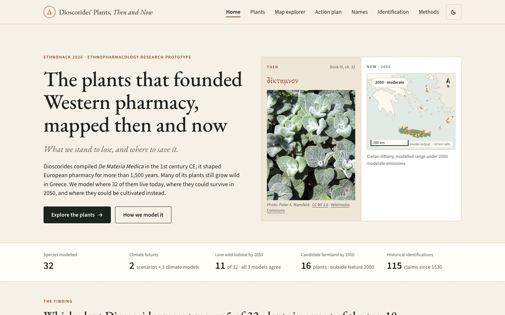
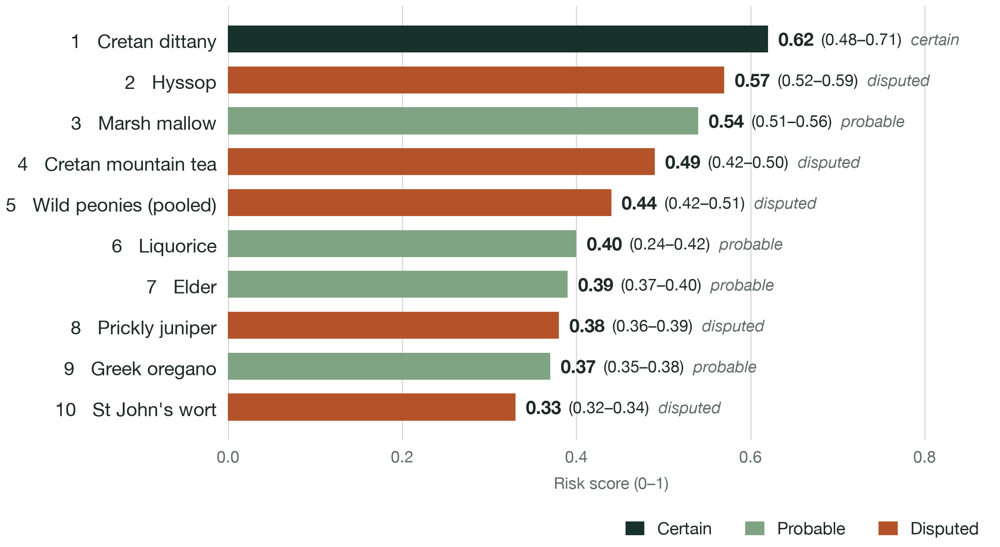
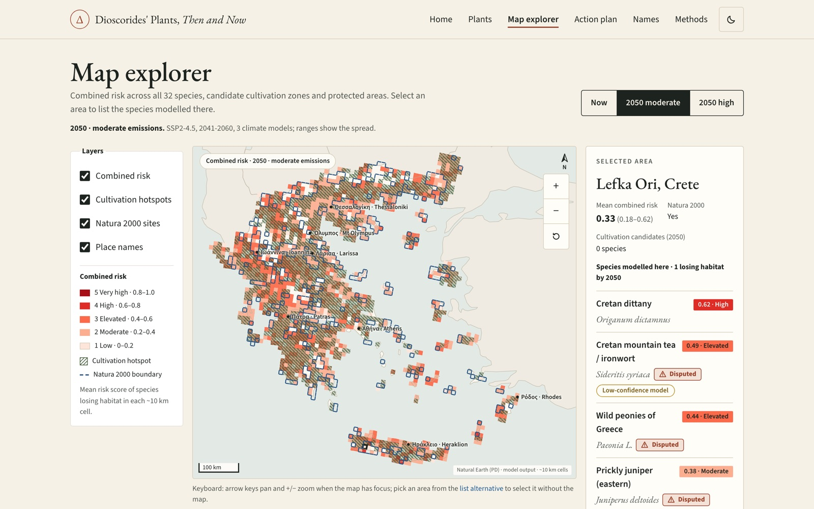
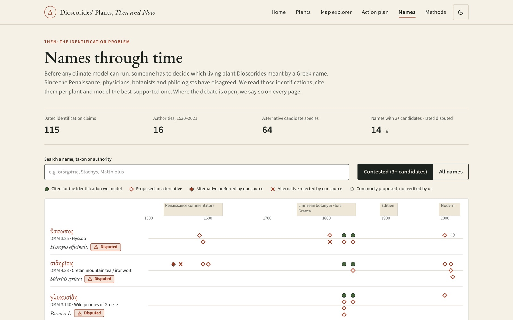
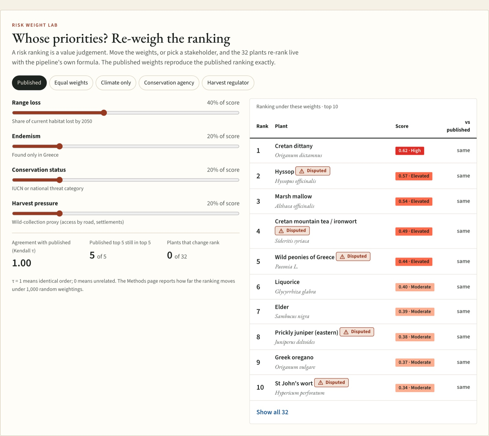
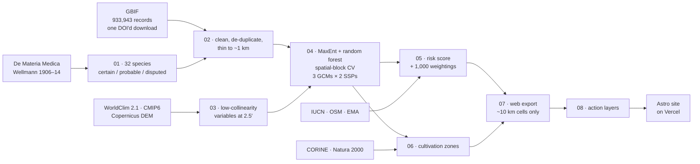

<div align="center">

# Materia Medica 2050

### The plants that founded Western pharmacy, mapped then and now: what we stand to lose, and where to save it

**[Live site](https://materia-medica-2050.vercel.app)** · **[Pitch deck (.pptx)](docs/materia-medica-2050.pptx)** · **[Project story](docs/devpost.md)** · **[Methods](https://materia-medica-2050.vercel.app/methods/)** · **[Limitations](LIMITATIONS.md)** · **[Data licences](DATA_LICENSES.md)**

EthnoHack 2026 · Track 3 · Ethnopharmacology research prototype

   

<a href="https://materia-medica-2050.vercel.app"></a>

</div>

> **Research prototype. Not medical advice.** Every result here is a model-based hypothesis with its uncertainty shown, not an established fact.

---

## At a glance

| | |
|---|---|
| **Question** | By 2050, which of Dioscorides' medicinal plants that grow wild in Greece are we most likely to lose, and where could we grow them instead? |
| **Scope** | 32 plants from *De Materia Medica* · all of Greece · 2041–2060 · 3 climate models × 2 emission scenarios |
| **Answer** | Cretan dittany ranks first. 11 of 32 plants lose wild habitat under every climate model, and 5 of those have no farmland to fall back on. |
| **Biggest caveat** | Drop the 9 plants whose ancient identification is disputed and half of the top 10 changes. The history of a name matters as much as the climate. |
| **Output** | A ranked, uncertainty-aware list, an action plan, a grower finder and an open pipeline that rebuilds everything with `make all`. |

## Key findings

<table>
<tr>
<td width="52%"></td>
<td width="48%"></td>
</tr>
<tr>
<td><sub>Top-10 risk score. The brackets give the score range across 3 climate models (SSP2-4.5).</sub></td>
<td><sub>Dittany's 2050 climate space on Crete: kept (sage), lost (rust), and the one cell suitable for cultivation (gold).</sub></td>
</tr>
</table>

1. **Cretan dittany (δίκταμνον) has nowhere to go.**
   - Its identification is certain and it grows only on Crete.
   - Under SSP2-4.5 it loses a median of **58%** of its climate range by 2050 (24% to 81% across climate models), and 65% under SSP5-8.5.
   - Only **one ~17 km² cell** of farmland could grow it instead.
2. **The future is split, not uniformly bleak.** 11 of 32 plants lose habitat under all three climate models, while the other 21 keep or gain climate space. Those gains are best-case, because they assume the plant can reach every new place.
3. **Names move the ranking as much as climate does.** Without the 9 disputed identifications, only **half of the top 10** stays the same.
4. **The ranking is robust to weighting.** Under 1,000 random weightings the top 10 holds **84%** of the time on average.
5. **Harvest pressure barely separates the plants.** Greece's road network saturates the access proxy, which spans only 0.86–0.99. We show this openly rather than hide it.

<details>
<summary><b>Top-10 table with ranges</b></summary>

| # | Plant | Identification | Range change 2050, SSP2-4.5 (median, min to max) | Risk score (range) |
|---|---|---|---|---|
| 1 | Cretan dittany, *Origanum dictamnus* | certain | −58% (−81 to −24) | **0.62** (0.48–0.71) |
| 2 | Hyssop, *Hyssopus officinalis* | disputed | −69% (−74 to −57) | **0.57** (0.52–0.59) |
| 3 | Marsh mallow, *Althaea officinalis* | probable | −62% (−68 to −55) | **0.54** (0.51–0.56) |
| 4 | Cretan mountain tea, *Sideritis syriaca* | disputed | −50% (−52 to −32) | **0.49** (0.42–0.50) |
| 5 | Wild peonies, *Paeonia* (pooled) | disputed | −24% (−41 to −17) | **0.44** (0.42–0.51) |
| 6 | Liquorice, *Glycyrrhiza glabra* | probable | −56% (−61 to −18) | **0.40** (0.24–0.42) |
| 7 | Elder, *Sambucus nigra* | probable | −48% (−52 to −42) | **0.39** (0.37–0.40) |
| 8 | Prickly juniper, *Juniperus deltoides* | disputed | −22% (−24 to −16) | **0.38** (0.36–0.39) |
| 9 | Greek oregano, *Origanum vulgare* | probable | −18% (−19 to −14) | **0.37** (0.35–0.38) |
| 10 | St John's wort, *Hypericum perforatum* | disputed | −9% (−10 to −5) | **0.33** (0.32–0.34) |

All 32 plants, with every component and interval, are in [`outputs/risk.csv`](outputs/risk.csv) and on the [Plants page](https://materia-medica-2050.vercel.app/plants/).
</details>

## Tour of the site

<table>
<tr>
<td width="50%"><a href="https://materia-medica-2050.vercel.app/plants/origanum-dictamnus/"></a><br><b>A page for every plant.</b> It has Dioscorides' Greek text with a link to the 1906 page scan, plus the Then/Now map with a scenario toggle. You also get the risk breakdown, model quality, a suggested action and every number's range.</td>
<td width="50%"><a href="https://materia-medica-2050.vercel.app/map/"></a><br><b>Map explorer.</b> Combined risk, cultivation hotspots and Natura 2000 sites on a ~10 km grid. Click any area to list the plants modelled there.</td>
</tr>
<tr>
<td><a href="https://materia-medica-2050.vercel.app/act/"></a><br><b>Action plan.</b> Habitat change × farmland in 2050 gives <b>6 plants to protect and cultivate</b>, <b>5 to protect with no fallback</b>, 10 cultivation opportunities and 11 to monitor.</td>
<td><a href="https://materia-medica-2050.vercel.app/act/#grow"></a><br><b>Grower finder.</b> Pick a ~10 km cell or a farming region to see what its 2050 climate could support. It shows which of those plants are shrinking in the wild and which have an EU herbal monograph, a sign that a regulated market exists. You can download the sheet as a CSV.</td>
</tr>
<tr>
<td><a href="https://materia-medica-2050.vercel.app/names/"></a><br><b>Names through time.</b> 115 dated identification claims by 16 authorities, 1530–2021: who proposed, preferred or rejected which plant for each Greek name.</td>
<td><a href="https://materia-medica-2050.vercel.app/plants/#lab"></a><br><b>Risk weight lab.</b> Move the weights or pick a stakeholder preset. The 32 plants re-rank live, with Kendall τ against our ranking.</td>
</tr>
</table>

## How it works



| Step | Method | Why it matters |
|---|---|---|
| **Identification** | Each Greek name is matched to a modern species from published scholarship and tagged certain, probable or disputed. | The ranking is reported with and without the disputed plants. |
| **Occurrences** | One GBIF download ([doi:10.15468/dl.4u6k8n](https://doi.org/10.15468/dl.4u6k8n)), cleaned and thinned to ~1 km. It doubles as a **target-group background**. | The models learn climate, not where botanists walk. |
| **Models** | MaxEnt (elapid) and random forest, scored by 5-fold ~25 km spatial-block CV against a null model. | Each model is scored on regions it never saw. Dittany: AUC **0.96** vs **0.49** null. |
| **Futures** | MPI-ESM1-2-HR, MRI-ESM2-0 and IPSL-CM6A-LR × SSP2-4.5 / SSP5-8.5, 2041–2060. | We report the median and the min to max, never a single run. |
| **Risk** | 0.4 range loss, 0.2 endemism, 0.2 status, 0.2 harvest proxy. Tested under 1,000 random weightings and ±50% one-at-a-time changes. | Shows whether the top of the list depends on our value judgements. |
| **Cultivation** | Suitable under the majority of GCMs, on CORINE farmland, outside Natura 2000, ≥ 5 km from wild records. | Farms never compete with the wild stands they are meant to protect. |

**Stack**
- **Pipeline:** Python 3.11 (rasterio, scikit-learn, elapid, geopandas), seeded and cached, with pytest.
- **Website:** Astro, React islands, MapLibre and Tailwind, deployed on Vercel.
- **Data contract:** JSON Schemas in `site/schema/` sit between the two. The site never computes science; it only displays the pipeline's exports.

## Responsible research

| Area | What we do |
|---|---|
| **Health claims** | None. Modern use is quoted only as the European Medicines Agency labels it, and the site is marked "not medical advice". |
| **Rare-plant privacy** | No exact coordinates are published, only ~10 km cells, so the site cannot become a map for collectors. |
| **Licences** | Every source, licence and attribution is in [`DATA_LICENSES.md`](DATA_LICENSES.md). No WorldClim rasters are redistributed. |
| **Traditional knowledge** | Our source is a published classical text. We collected no knowledge from living communities. |
| **AI use** | AI assistants helped with code and with gathering sources. Every identification links to its source and page scan so anyone can check it. |
| **Limits** | Correlative models, sampling bias, a saturated harvest proxy and a coarse public grid. All nine limits are in [`LIMITATIONS.md`](LIMITATIONS.md). |

## Roadmap

- [ ] Expert review of the disputed identifications with botanists working on the Flora of Greece
- [ ] Split pooled taxa (such as the Greek peonies) as records allow
- [ ] Test the cultivation zones with collectors' cooperatives in Crete, with consent and shared benefit
- [ ] Replace the access proxy with measured harvest data (permits, trade volumes)
- [ ] Extend to Cyprus and Anatolia

---

## Quick start

```bash
# Website only: the published results are committed in site/public/data
cd site && npm ci && npm run dev                          # http://localhost:4321

# Full reproduction from raw downloads (~25 min plus downloads)
cp .env.example .env            # GBIF account + IUCN token
make env && conda activate dioscorides      # or: python3.11 -m venv .venv && .venv/bin/pip install -r requirements.txt
# put the CORINE 2018 raster in data/raw/corine/ and the Natura 2000 GeoPackage in data/raw/natura2000/ (see below)
make all                        # data → models → risk → web export → tests → site build
```

- `make help` lists every target. Each stage is idempotent and cached, and `FORCE=1 make <target>` recomputes it.
- `npm run data:sample` overwrites `site/public/data` with clearly labelled synthetic data for design work. Don't run it unless you mean to.

## Repository

```text
data/curated/       species.csv, identifications.csv (hand-curated, committed)
data/raw/           downloads (git-ignored)      data/processed/  intermediate (git-ignored)
data/manifest.yml   GBIF download DOI, data versions (written by the pipeline)
pipeline/01–08      one script per stage; shared, unit-tested logic in pipeline/lib/
outputs/            metrics/<slug>.json, risk.csv, sensitivity.json, cultivation.csv
site/               Astro + React islands + MapLibre + Tailwind; reads site/public/data/
site/schema/        JSON Schema for every file the site reads (the data contract)
tests/              cleaning filters, risk maths, export schema
docs/               pitch deck and README images
```

| Stage | Script | Does |
| --- | --- | --- |
| 1 | `01_species.py` | Checks `species.csv` and resolves names on the GBIF Backbone. |
| 2 | `02_occurrences.py` | Makes one DOI'd GBIF download of all vascular plants in the study box (also the model background). Drops missing or zero coordinates, country centroids, institutions, duplicates, pre-1970 records and uncertainty over 5 km, then thins to ~1 km. |
| 3 | `03_environment.py` | Gets WorldClim 2.1 bioclim at 2.5′ (baseline plus 3 GCMs × SSP2-4.5/SSP5-8.5, 2041–2060) and Copernicus DEM elevation and slope. Keeps variables with \|r\| < 0.7. Reads only the Greece window over HTTP. |
| 4 | `04_models.py` | Fits MaxEnt (elapid) and random forest with a target-group background. Scores them with 5-fold ~25 km spatial-block CV (AUC, TSS, Boyce, null model) and projects to every GCM × SSP. |
| 5 | `05_risk.py` | Combines range loss, endemism, status (IUCN or checklist) and a harvest proxy (OSM, 2 km) with weights 0.4/0.2/0.2/0.2. Runs 1,000 random weightings, ±50% one-at-a-time sensitivity, and the ranking with and without disputed IDs. |
| 6 | `06_cultivation.py` | Selects cells suitable in 2050 under more than 50% of GCMs, on CORINE farmland or transitional land, outside Natura 2000 and at least 5 km from wild records. |
| 7 | `07_export_web.py` | Writes ~10 km EPSG:3035 cells as GeoJSON (never points), species JSON and `meta.json`. Validates against `site/schema/` and fails on layers over 300 KB. |
| 8 | `08_action_layers.py` | Standard library only; reads the stage-7 exports. Writes a per-cell grower index (validated against stage 7's cultivation counts, 0 mismatches) and `lineage.json`, which holds every dated identification claim since 1530. |

### Inputs that are not fetched automatically

- **CORINE Land Cover 2018**, 100 m raster (free Copernicus account).
  - Download it from https://land.copernicus.eu/en/products/corine-land-cover/clc2018. The Greece-only area is enough.
  - Put the `.tif` anywhere in `data/raw/corine/`. Stage 06 reads only the Greece window.
- **Natura 2000, end-2024 release** (EEA, CC BY 4.0, public).
  - Get `Natura2000_end2024.gpkg` from the EEA datashare (`eea_v_3035_100_k_natura2000_p_2024_v01_r00`).
  - We keep only the Greek sites, in `data/raw/natura2000/Natura2000_end2024_GR.gpkg` (446 sites).

The pipeline downloads everything else. WorldClim and the Copernicus DEM are read straight from the provider for the Greece window only, so no global file is ever stored.

## Website

- **Live:** https://materia-medica-2050.vercel.app, deployed on Vercel from `site/`.
- **Pages:** Home, Plants (with the risk weight lab), a page per plant, Map explorer, Action plan (`/act`), Names through time (`/names`), and Methods & limitations.
- **Themes:** light and dark. Design tokens live in `site/src/styles/tokens.css`.
- **No science on the site.** It only displays `site/public/data/`. When `meta.json` has `"sample": true`, every page shows a **Sample data** banner.
- **CI:** runs pytest, including schema validation (`.github/workflows/site.yml`).

## Open items

- Open the IUCN Red List and GBIF terms pages in a browser and confirm that public display is allowed. Both blocked automated checks; see `DATA_LICENSES.md`.
- Ask WorldClim (info@worldclim.org) whether a public site showing derived 10 km model outputs is acceptable.
- Plants whose identification citation, EMA status or wild-harvest evidence could not be verified carry the reason in the `unverified` column of `data/curated/species.csv`.

## How to cite

> Chatti, S. & DurgaPritam (2026). *Materia Medica 2050: Dioscorides' plants, then and now.* EthnoHack 2026. https://github.com/SoujanyaChatti/Materia-Medica-2050
>
> Occurrence data: GBIF.org (3 November 2026) GBIF Occurrence Download https://doi.org/10.15468/dl.4u6k8n

## Team

Built for EthnoHack 2026 by **Soujanya Chatti** and **[DurgaPritam](https://github.com/DurgaPritam)**.

## Licence

Code: MIT ([`LICENSE`](LICENSE)). Data: see [`DATA_LICENSES.md`](DATA_LICENSES.md). Basemap: Natural Earth (public domain).
